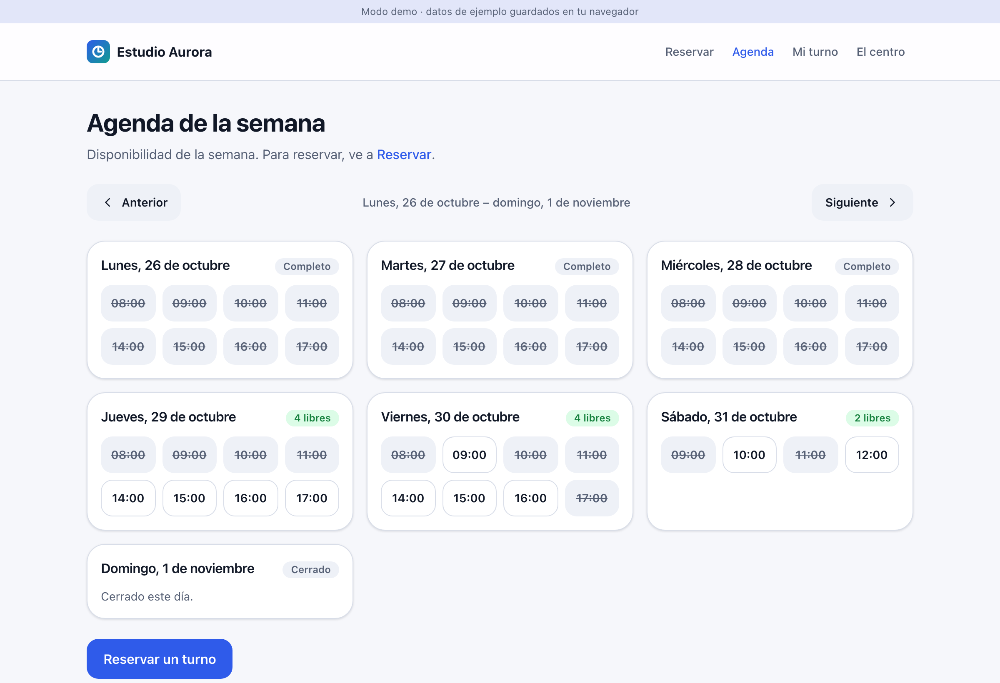
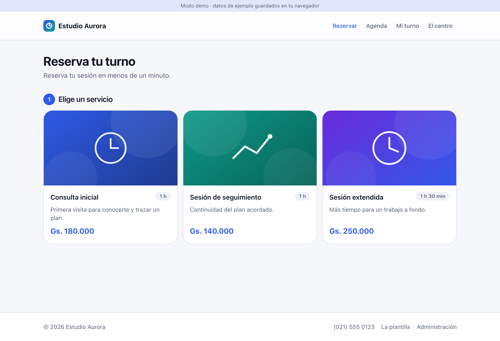
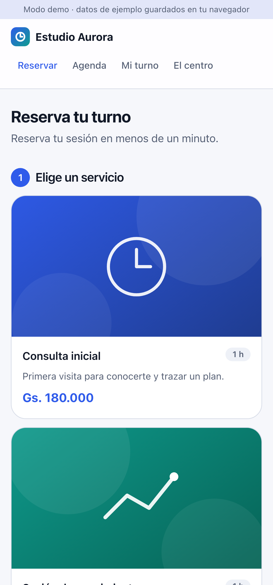

<div align="center">

# 📅 Agenda

### A white-label appointment-booking app: patients book from their phone against a live availability grid, and the business runs the week from an admin panel.

[](https://react.dev)
[](https://www.typescriptlang.org)
[](https://vite.dev)
[](https://tailwindcss.com)
[](https://supabase.com)
[](#how-its-built)
[](LICENSE)

### [▶  Try the live demo](https://diego-salomon.github.io/agenda/)

<sub>Runs entirely in your browser. No sign-up, no backend, pre-loaded with example data.</sub>

<br>



</div>

---

## What it does

A booking tool a small appointment-based business can hand to its clients:

- **Patients book in under a minute**, from a phone, against a live availability grid. No account, just a confirmation code they keep.
- **The business runs its week** from an admin panel: see the day, cancel or move a booking, mark it attended, and block or free slots.
- **The grid stays honest.** Taken slots are crossed out, free ones stand out, and each day shows full, how many are open, or closed.

## Who it's for

- **Small appointment-based businesses** (a studio, a clinic, a salon) that want online booking without paying for bespoke software.
- **Freelancers and agencies** who set these up for clients and want a finished, branded booking app to ship by editing two files.

## What it looks like

<div align="center">
<table>
<tr>
<td align="center" width="60%"><br><sub>Pick a service and a slot</sub></td>
<td align="center" width="40%"><br><sub>Built for the phone</sub></td>
</tr>
</table>
</div>

## Make it yours (white-label)

Everything client-specific lives in **two files**. No brand string is hard-coded in a component, and every currency and date is formatted from the locale and currency.

- [`src/config/brand.config.ts`](src/config/brand.config.ts) — name, tagline, logo, palette, locale, currency, contact, socials, phone rules.
- [`src/config/agenda.config.ts`](src/config/agenda.config.ts) — the services catalog, opening hours, and notification copy.

Fill those in, set the palette, and `pnpm dev` shows the client's full working demo.

## How it's built

Clean architecture, layered so the backend sits behind a single port. The domain and application layers are pure and unit-tested, with no framework and no I/O.

```
src/domain/          pure business rules, no I/O, unit-tested
src/application/     use cases over the AgendaRepository port (the backend seam)
src/infrastructure/  adapters: localStorage (demo), Supabase (live), notifications
src/ui/              React screens, identical in both modes
src/app/container.ts the only place that picks adapters, by VITE_MODE
```

The **same code runs two ways**, chosen by one env variable:

- **Demo mode** (`VITE_MODE=demo`, default): everything in the browser on `localStorage`, pre-seeded. For sales demos and portfolios.
- **Live mode** (`VITE_MODE=live`): a real [Supabase](https://supabase.com) backend (Postgres, Auth, Row Level Security).

Switching modes swaps adapters in `container.ts` and changes nothing above `src/infrastructure`.

## Quick start

```bash
pnpm install
pnpm dev          # demo mode, http://localhost:5173
```

A full working demo on `localStorage`, no backend needed.

```bash
pnpm test         # unit tests (domain + application + infra)
pnpm test:e2e     # Playwright, desktop + mobile
pnpm build        # typecheck + production build
```

---

<div align="center">
<sub>Built by <a href="https://github.com/diego-salomon">Diego Salomón</a>. · <a href="https://www.linkedin.com/in/diegosalomon">LinkedIn</a></sub>
</div>
